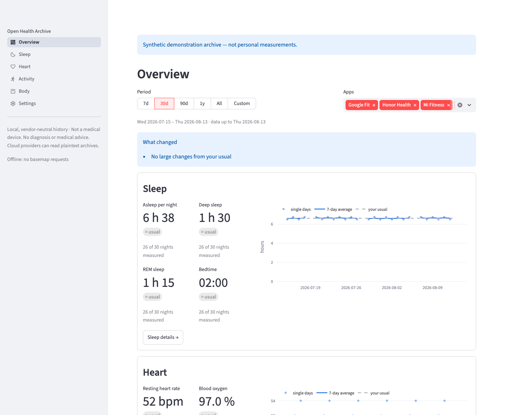

# Open Health Archive

Open Health Archive keeps your health history in plain CSV and GPX files in a folder you
own, imports it from Android's Health Connect and from Xiaomi's Mi Fitness, and shows it
in a dashboard that runs locally in Docker. Nothing is uploaded. Status: early development.



## Why this exists

Health Connect collects health data on Android from many apps (watches, bands, scales,
the phone itself), but it has no dashboard for looking at that history as a whole. Each
vendor's app shows only its own data, and when several apps record the same measurement
the records overlap and have to be reconciled before they can be added up.

The maintainer needed to view older Xiaomi watch history, exported from Mi Fitness, next
to newer data from Health Connect, without counting the same watch twice. Open Health
Archive does that: it imports Health Connect's daily export and other providers into one
vendor-neutral archive, lets you mark two sources as the same physical device, and shows
sleep, heart, activity, routes and body measurements for one app, several or all of them.

## Try the demo

Requires Docker Desktop with Compose. The viewer reads its settings from a private folder
that must exist:

```sh
mkdir -p "$HOME/.config/healthviz"
chmod 700 "$HOME/.config/healthviz"
docker compose build
docker compose up -d viewer
```

Open `http://127.0.0.1:8501` to see a small, clearly labeled synthetic archive. To view
your own data, use the one-command start below.

## Start with one command

`start.sh` (macOS, Linux) imports the newest Health Connect export and opens the viewer
at `http://127.0.0.1:8501`. Docker is the only requirement.

```sh
./start.sh            # import the newest export and open the viewer
./start.sh --choose   # pick the folders again
./start.sh --xiaomi "/absolute/path/to/extracted-export"   # import a Mi Fitness export
```

The first run asks, with the system folder dialog, for the archive folder and for the
folder where you download Health Connect exports (any folder, e.g. Downloads). On
Linux without `zenity` or `kdialog` it asks in the terminal. The choices are saved in
`~/.config/healthviz/launcher.conf` (`HEALTHVIZ_CONFIG_DIR` changes the folder). It
also saves this computer's IANA timezone in `config.toml` beside it, so an import never
assumes UTC.

Each run rebuilds the image when the checkout changed (offline it keeps the existing
image), stops the viewer, imports in a container that sees only the export folder
(read-only), the archive and the private config (the Xiaomi import keeps network access
for its signed track links), then starts the viewer read-only, with the persistent local
read model in the OS cache folder
(`~/Library/Caches/OpenHealthArchive/viewer` on macOS,
`~/.cache/open-health-archive/viewer` on Linux; `HEALTHVIZ_CACHE_DIR` overrides it).
If the import fails, the viewer still starts with the previous data and its sidebar
shows why.

## Import Health Connect's daily export

In Health Connect's settings on the phone, turn on the scheduled daily export to
Google Drive. Download the newest `Health Connect.zip` into your
export folder and run the start command, or import by hand:

```sh
HEALTHVIZ_IMPORT_DIR="/absolute/path/to/Downloads" \
HEALTHVIZ_ARCHIVE_DIR="/absolute/path/to/HealthExport" \
HEALTHVIZ_CONFIG_DIR="$HOME/.config/healthviz" \
HEALTHVIZ_CACHE_DIR="$HOME/Library/Caches/OpenHealthArchive/viewer" \
  docker compose -f compose.yaml -f compose.launcher.yaml run --rm import
```

Stop the viewer first: never import while consulting. The importer:

- picks the newest zip in the folder that contains `health_connect_export.db`
  (browser renames such as `Health Connect (1).zip` are fine) and skips one it
  already imported; your zips are never changed or deleted;
- imports every app and every type with an archive table under ingest
  `health_connect` with the app in `source_app`; types without a table (today
  elevation gained and steps cadence) are counted as "not imported";
- updates edited records and removes records deleted in Health Connect only inside
  the period the export covers for that type and app, so Health Connect's automatic
  deletion of old data, or an app removed from Health Connect, never erases history;
- stops without touching the archive when the format changed (missing columns, or
  values implausible enough to suggest a unit change); a new format version with the
  same columns imports with a "not yet tested" warning;
- rolls back an interrupted write immediately, or on the next run.

The Xiaomi importer stays available for older history. Both write to the same
archive; associate the Xiaomi watch and the Health Connect Mi Fitness device once
with "Same physical device as" and overlaps are never added together. The sidebar
"Apps" filter shows one, several or all apps; the Xiaomi history and Mi Fitness via
Health Connect appear together as "Mi Fitness".

To support another source, see [docs/adding-an-importer.md](docs/adding-an-importer.md).

## Import a Mi Fitness export

`./start.sh --xiaomi "/absolute/path/to/extracted-export"` stops the viewer, imports the
export into the same archive and opens the viewer again. It downloads the GPX tracks,
which needs network access, and imports in this computer's timezone, saved in
`config.toml`; the saved Health Connect folder is left alone. Run it once per export; plain
`./start.sh` keeps importing Health Connect as usual.

To import by hand instead, with an explicit timezone: build the image first with
`docker compose build`. Keep private files OUTSIDE this repository. Choose separate
absolute host paths for the extracted export, saved GPX folder and output archive.
Create the output folder yourself before running:

```sh
EXPORT_DIR="/absolute/path/to/extracted-export"
TRACKS_DIR="/absolute/path/to/saved-tracks"
ARCHIVE_DIR="/absolute/path/to/HealthExport"

docker run --rm --network none --cap-drop ALL \
  --security-opt no-new-privileges:true \
  --mount "type=bind,src=$EXPORT_DIR,dst=/input/export,readonly" \
  --mount "type=bind,src=$TRACKS_DIR,dst=/input/tracks,readonly" \
  --mount "type=bind,src=$ARCHIVE_DIR,dst=/output" \
  open-health-archive-dev uv run --no-sync healthviz import xiaomi /input/export \
  --out /output --tracks-dir /input/tracks --timezone Europe/Rome
```

`--timezone` (or `--config`, for a settings file that saves `default_timezone`) is
required: use your home IANA timezone, not the container's UTC setting. Without a saved
timezone the import stops instead of assuming UTC. Vendor offsets take precedence where provided; travel offsets for minute
samples are estimates based on nearby sleep/workout records. Minute interval ends
are inferred as timestamp +60 seconds; confirm them against vendor documentation
before comparing fine-grained interval data across manufacturers.

The importer also accepts a ZIP without extracting it. Re-imports upsert the same
records across partitions and preserve other ingestion sources. Corrected sessions
replace their owned sleep stages; corrected steps can retract derived distance.
Device IDs are stable source-local pseudonyms, not model names or anonymization.
Associating the same physical watch across different adapters requires explicit
mapping; it cannot be inferred safely from names. Track backups use `<Time>.gpx` names.
If a GPX backup is missing, the importer attempts the vendor download URL: that needs
network access and the link may have expired. The offline command above instead
reports a missing track and continues. Never mount originals writable or mount your
home or Docker socket.

See `schema/export-schema.md` for the contract. Error messages omit input values;
record counts and warning counts are printed. Existing archives must validate before
any update. If an archive is corrupt or an interrupted import left an inconsistent
manifest, rebuild to a NEW output folder and retain the old folder for inspection;
never silently repair or overwrite it. Do not run concurrent imports to the same
archive. Store the output privately and back it up.

## Consult an archive locally

Keep the archive and personal configuration outside this repository. Google Drive
files must be fully available locally before mounting them. Create a private config
directory (only this directory is mounted, not your home):

```sh
mkdir -p "$HOME/.config/healthviz"
chmod 700 "$HOME/.config/healthviz"
docker compose build
HEALTHVIZ_ARCHIVE_DIR="/absolute/path/to/HealthExport" docker compose up -d viewer
```

Open `http://127.0.0.1:8501`. Without `HEALTHVIZ_ARCHIVE_DIR`, the viewer uses the
clearly labeled synthetic demonstration archive. Set `HEALTHVIZ_CONFIG_DIR` to choose
another private settings directory. The archive is mounted read-only. In the Linux
Docker runtime, validated CSV input buffers stay in memory and are released after each
bounded batch; no temporary CSV cache is written to disk. Settings are saved separately
in `config.toml`; source associations must be explicit, never based on identical model
names. Advanced per-device ingest orders can be edited in the
private TOML `[ingest_priority]` table.

Offline consultation disables all basemap requests:

```sh
HEALTHVIZ_ARCHIVE_DIR="/absolute/path/to/HealthExport" docker compose run --rm \
  --service-ports viewer healthviz view /archive --container \
  --config /config/config.toml --offline
```

Stop an existing viewer first with `docker compose stop viewer` to free port 8501.
The host binding remains loopback; `--lan` never changes Docker port publication.
Daily coverage is hours containing heart-rate samples, not verified wear time.
Incomplete days and absent values are not zero and do not enter eligible means.
Recorded offsets can be estimates and cannot describe a timezone change within one
long session. Cross-hour interval allocation is proportional and marked estimated.
Overnight workout minutes are also allocated proportionally across local midnights.
Period `complete` describes HR coverage only; each metric additionally reports its
eligible covered-day count and completeness. Partial totals are never extrapolated.
CSV downloads include the selected period only; rolling chart means use preceding
history outside the visible range. Plotly charts offer PNG downloads.
Vendor fallback is never added to raw data. Do not import or sync files while
consulting; a changing/inconsistent snapshot is rejected rather than silently read.

### Resting heart rate: history, estimates and unavailable values

An original vendor export can supply the initial history while Health Connect alone
supplies subsequent updates. The original app does not need to be imported again.
Metric availability can differ: ordinary heart-rate samples do not imply that Health
Connect also contains a source-provided resting heart rate.

The Heart and Overview charts distinguish **Provided by source** (circles) from
**Estimated from sleep** (diamonds). Hover text identifies the source app and importer
for supplied values. A supplied Health Connect value is not labeled historical simply
because a device or app computed it. Proprietary source methods and viewer estimates
may differ; the viewer does not calibrate one to the other.

If a source-provided resting value is unavailable, the viewer estimates it from the
lowest time-weighted mean in a supported 30-minute window during the main eligible
sleep session. The day must meet the configured HR-coverage threshold (10 hours by
default). A window needs at least six samples and 24 minutes of support, with each
sample supporting no more than five minutes and the final sample providing no following
support. No reading or sleep stage is invented to fill gaps.

The Day view explains an unavailable value; the Heart raw table and CSV retain the
first blocking reason, such as incomplete daily coverage, no eligible main sleep, or
insufficient heart-rate samples during that sleep. This reason is not an exhaustive
list of problems. Missing values stay empty, never zero or copied from history. A
recorded value on an incomplete day remains inspectable but is excluded from the daily
charts and averages. A missing chart point does not by itself indicate stale cache.

These labels and explanations do not change calculation thresholds, source priorities,
or aggregate eligibility. Existing disposable read-model caches rebuild automatically
for the updated metadata; no archive migration or reimport is needed.

## Optional persistent local preparation

`start.sh` always enables a disposable DuckDB read model in the OS cache folder. With
the manual Compose commands the viewer creates no persistent health-data database; to
speed up new sessions and process restarts, enable it explicitly as described here.
CSV/GPX and the manifest remain canonical; deleting this cache loses no archive data.
It stores a **second plaintext copy** of raw tables, daily summaries and Overview
sleep/workout context. It does not store GPX points, map density or observation messages.

Choose a separate directory outside the repository, archive and configuration, and
outside automatic Drive/iCloud sync. Check local backup policy too. On macOS the
recommended location is `$HOME/Library/Caches/OpenHealthArchive/viewer`. Keep the
parent private, then create the empty viewer directory using the non-root container
identity (Docker Desktop may report a host-created directory with a different UID):

```sh
CACHE_PARENT="$HOME/Library/Caches/OpenHealthArchive"
mkdir -p "$CACHE_PARENT"
chmod 700 "$CACHE_PARENT"
docker run --rm --network none --cap-drop ALL \
  --security-opt no-new-privileges:true \
  --mount "type=bind,src=$CACHE_PARENT,dst=/cache-parent" \
  open-health-archive-viewer python -c \
  'import os; os.mkdir("/cache-parent/viewer", 0o700)'

HEALTHVIZ_ARCHIVE_DIR="/absolute/path/to/HealthExport" \
HEALTHVIZ_CACHE_DIR="$CACHE_PARENT/viewer" \
  docker compose -f compose.yaml -f compose.cache.yaml up -d viewer
```

Create the directory only once; do not overwrite an existing directory or change
archive/config permissions to fix access. The cache requires an owned directory with
mode `0700` and generated files with mode `0600`. Unsafe paths, symlinks, shared
permissions and archive/config/code overlap are refused. The overlay requires an
explicit `HEALTHVIZ_CACHE_DIR` and never creates a missing host directory automatically.
The archive stays read-only, configuration stays separate, and only `/cache` is added.
Never mount the home directory or Docker socket. Bind aliases/nesting outside the
container namespace cannot all be detected: verify all three **host** paths are disjoint.

For offline cached consultation, use the same two Compose files and environment
variables with `run --rm --service-ports viewer healthviz view /archive --container
--config /config/config.toml --cache-dir /cache --offline` instead of `up`. Stop an
existing viewer yourself before reusing port 8501; the overlay retains loopback binding.
Omit the overlay and `--cache-dir` to keep the original nonpersistent mode.

First preparation may be slower; later starts skip CSV parsing and full daily analysis.
Every rerun still hashes current CSV/GPX content, and disk reads verify the DB before
and after materialization; a viewer process then reuses what it read, for refreshes
and new tabs, while the file and its pointer are unchanged. This is not a promise of
a particular speedup. Changed sources/code invalidate preparation; settings or
analysis-only changes reuse validated raw tables and store their results in a small
separate file, so returning to an earlier Apps choice is a hit (at most 64 are kept).
Each viewer process, and each change of data or non-Apps settings, starts a
low-priority background process that prepares the other Apps choices: every
combination up to six apps, otherwise each app alone. While it runs it uses CPU and
holds a second in-memory copy of the archive tables; it keeps about one extra results
file per choice. When the archive or non-Apps settings change, it stops and the run
for the new state takes over. Period filters and historical end dates
remain computed on demand using full-history inputs. First Map use still parses
tracks and computes density.

Only completed immutable generations are published. Threads/processes coordinate
through file locks; interrupted builds and corrupt DBs rebuild from a valid archive.
An invalid/changing archive never falls back to an old DB. Stop sync/import jobs
while consulting. Replacement temporarily needs space for old and new generations.
Cache errors do not repair or modify the archive or settings.

To force a fresh preparation, stop cache-using viewers and remove only generated
files in this dedicated cache directory; retain the directory and its permissions.
Disabling persistence does not remove old cache files. File deletion is not secure
erasure and does not delete OS/back-up copies. Protect this directory like the archive.

## Privacy

Archives are plaintext. A cloud storage provider can read them if you sync them to
Google Drive or another service. Healthviz does not upload files. GPS tracks reveal
locations: keep archives private and backed up. Online maps request OSM tiles in
the browser, revealing the viewed area to that provider; `--offline` uses no basemap.
Streamlit telemetry and remote deployment controls are disabled. A standard-library
audit hook blocks Python socket connections and outbound DNS before framework
startup; it is not a sandbox for arbitrary native code. A persistent health-data
cache is created only with `--cache-dir`, which `start.sh` passes; this read model is
a separate disposable plaintext copy, not an upload or a replacement archive.
Keep sync/import jobs stopped while consulting.
Containers protect original exports
only when they are mounted read-only; Docker does not encrypt them.

This is not a medical device and provides no diagnosis or medical advice.

## Development

Requires Docker Desktop with Compose. Python and uv stay inside Docker. GitHub Actions
runs the same checks on every push and pull request.

```sh
docker compose build
docker compose run --rm dev uv run --no-sync pytest
docker compose run --rm dev uv run --no-sync ruff check .
docker compose run --rm dev uv run --no-sync ruff format --check .
```

Tests run without networking and receive no personal data. The development container
mounts only this repository and runs as an unprivileged user.

Read [AGENTS.md](AGENTS.md) before contributing: its rules on privacy, missing data and
tests apply to every change. To support another source, see
[docs/adding-an-importer.md](docs/adding-an-importer.md). Report security or privacy
problems privately as described in [SECURITY.md](SECURITY.md).

## License

MIT, see [LICENSE](LICENSE). Open Health Archive is an independent project, not
affiliated with or endorsed by Google, Xiaomi or any other vendor. Health Connect,
Mi Fitness and other product names are trademarks of their owners.
